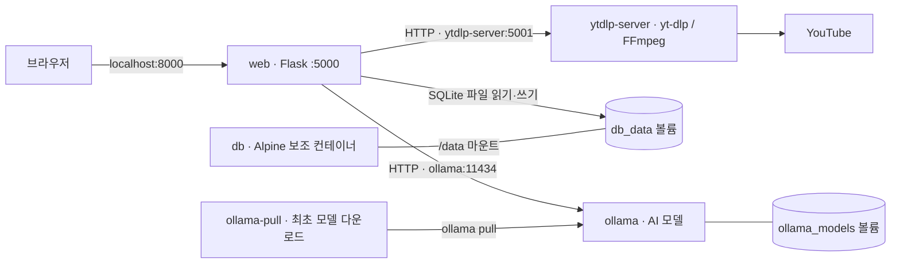

# MUSIC LOUNGE

장르별 라운지에서 YouTube 플레이리스트를 공유하고 실시간으로 대화하는 웹 앱입니다. Flask와 SQLite를 사용하며, YouTube 메타데이터 추출과 MP3 변환은 별도의 yt-dlp API 서버가 담당합니다.

- 작업 저장소: [leetaegyeong126/MUSIC-LOUNGE](https://github.com/leetaegyeong126/MUSIC-LOUNGE)
- 원본 프로젝트: [2026-Open-Source-Software/MUSIC-LOUNGE](https://github.com/2026-Open-Source-Software/MUSIC-LOUNGE)

이 문서는 `develop`에 반영된 코드와 설정을 기준으로 합니다. 원본 프로젝트 PR의 반영 범위는 아래 [PR 반영 기준](#pr-반영-기준)에 정리했습니다.

## 주요 기능

- **계정과 보관함**: 로그인·신규 계정 생성, 프로필 수정, 플레이리스트 생성·수정·삭제, 여러 라운지에 공유
- **장르별 라운지**: 기본 발라드·R&B·힙합·인디 라운지, DB의 라운지 정보 조회, 공유 목록과 좋아요
- **실시간 소통**: SSE 기반 메인 라운지 채팅·참여자·공유 목록 변경 알림, 계정별 참여 인원 표시, 한국 시간 기준 채팅 날짜 구분선
- **YouTube 가져오기·재생**: 공개 영상·재생목록의 곡 정보 가져오기, MP3 준비·캐시·재생
- **현재 재생 UI**: NOW LISTENING에서 선택한 플레이리스트 표시, 재생·일시정지, 재생 위치 이동, 세로 슬라이더로 음량 조절. 청취자 목록과 개별 라운지 채팅은 UI만 구성
- **AI 노래 추천**: 내 플레이리스트 기반 비슷한 곡 추천, Ollama 기반 분위기 추천. 실존하는 곡만 표시하고 결과는 요청한 사람에게만 보임 ([AI 노래 추천](#ai-노래-추천))

프론트엔드는 Jinja 템플릿, 일반 JavaScript ES modules, CSS로 구성합니다. 별도의 Node.js 빌드 과정은 없습니다.

## 빠른 실행: Docker Compose

Docker와 Docker Compose를 사용할 수 있는 환경에서 실행합니다.

```sh
git clone https://github.com/leetaegyeong126/MUSIC-LOUNGE.git
cd MUSIC-LOUNGE
docker compose up --build -d
```

처음 실행하면 `ollama-pull`이 AI 모델(`gemma4`, 약 6.6GB)을 내려받습니다. 다운로드가 끝나기 전에도 사이트와 "비슷한 곡 추천"은 사용할 수 있고, 분위기 추천만 완료 후 동작합니다. 진행 상황은 `docker compose logs -f ollama-pull`로 확인합니다.

| 화면·서비스 | 주소 |
| --- | --- |
| 메인 | http://localhost:8000/ |
| 로그인·회원가입 | http://localhost:8000/login |
| 마이페이지 | http://localhost:8000/mypage |
| yt-dlp 상태 확인 | http://localhost:5001/health |

```sh
docker compose ps
docker compose logs -f web ytdlp-server
docker compose down
```

`docker compose down` 후에도 DB 볼륨은 유지됩니다. `docker compose down -v`는 계정·플레이리스트·채팅과 MP3 캐시가 담긴 볼륨을 삭제하므로 데이터 초기화가 필요한 경우에만 사용하세요.

### 컨테이너 구조



| Compose 서비스 | 컨테이너명 | 역할 | 호스트 포트 | 마운트 |
| --- | --- | --- | --- | --- |
| `web` | `music-lounge-app` | 화면, 인증, REST API, SSE, SQLite 접근, MP3 캐시 | `8000 → 5000` | 프로젝트 `.:/app`, `db_data:/app/instance` |
| `ytdlp-server` | `music-lounge-ytdlp` | 메타데이터 추출, YouTube 검색, 오디오 다운로드·MP3 변환 | `5001 → 5001` | 별도 영속 볼륨 없음 |
| `db` | `music-lounge-db` | `db_data` 볼륨을 공유하는 Alpine 컨테이너 | 없음 | `db_data:/data` |
| `ollama` | `music-lounge-ollama` | AI 노래 추천의 분위기 추천에 쓰는 로컬 LLM 서버 | 없음 (내부망 `ollama:11434`) | `ollama_models:/root/.ollama` |
| `ollama-pull` | `music-lounge-ollama-pull` | `ollama`가 준비되면 모델을 내려받고 종료. 이미 받은 모델은 다시 받지 않음 | 없음 | 없음 |

**SQLite는 `web` 프로세스가 직접 사용하는 파일 DB입니다.** `db` 컨테이너는 `tail -f /dev/null`로 유지되며 MySQL·PostgreSQL 같은 DB 서버를 실행하지 않습니다. Nginx 컨테이너도 현재 구성에는 없습니다.

Compose에서는 DB가 `/app/instance/lounge.sqlite3`, 캐시가 `/app/instance/audio/`에 저장됩니다. 이 경로는 이름 있는 `db_data` 볼륨에 연결되므로 호스트 프로젝트의 `instance/`와는 별개입니다. yt-dlp 서버는 변환에 임시 디렉터리를 사용하고, 응답 종료 시 정리하도록 구현되어 있습니다.

`web`의 `depends_on`은 컨테이너 시작 순서를 지정합니다. `ollama`에만 준비 확인(healthcheck)이 있고 `ollama-pull`이 이를 기다립니다. 나머지 서비스는 준비 완료를 검사하지 않으므로 시작 직후 미디어 요청이 실패하면 로그와 `/health`를 확인하세요.

## 로컬 개발 실행

Docker 없이 실행할 때도 **웹 앱과 yt-dlp API 서버를 각각 실행**해야 곡 정보 가져오기와 MP3 재생을 사용할 수 있습니다. Dockerfile의 Python 버전은 3.11입니다. MP3 변환에는 yt-dlp 서버 환경의 FFmpeg·FFprobe가 필요합니다.

### 1. 웹 앱 환경 준비

```sh
python3 -m venv .venv
source .venv/bin/activate
python -m pip install -r requirements.txt
```

Windows PowerShell에서는 `python -m venv .venv`로 생성한 뒤 `.\.venv\Scripts\Activate.ps1`로 활성화합니다.

### 2. yt-dlp 서버 실행: 별도 터미널

```sh
python3 -m venv ytdlp_server/.venv
source ytdlp_server/.venv/bin/activate
python -m pip install -r ytdlp_server/requirements.txt
ffmpeg -version
ffprobe -version
python ytdlp_server/app.py
```

Windows에서는 `python -m venv ytdlp_server/.venv`로 생성하고 `.\ytdlp_server\.venv\Scripts\Activate.ps1`로 활성화합니다. FFmpeg·FFprobe는 PATH에 등록해야 합니다.

### 3. 웹 앱 실행: 첫 번째 터미널

macOS / Linux:

```sh
export YTDLP_SERVER_URL=http://127.0.0.1:5001
export FLASK_DEBUG=1
python app.py
```

Windows PowerShell:

```powershell
$env:YTDLP_SERVER_URL = 'http://127.0.0.1:5001'
$env:FLASK_DEBUG = '1'
python app.py
```

직접 실행한 웹 앱은 http://localhost:5000/ 에서 열립니다. 5000번 포트가 사용 중이면 다음처럼 다른 포트로 실행합니다.

```sh
python -m flask --app app run --host 127.0.0.1 --port 8000 --debug
```

HTML 파일을 직접 열거나 Live Server로 실행하면 Flask API와 템플릿이 동작하지 않습니다. 디버그 모드가 꺼져 있으면 Python·템플릿 변경 후 서버를 재시작하세요. CSS·JavaScript 변경이 보이지 않으면 브라우저를 강력 새로고침합니다.

### 환경 변수

| 변수 | 기본값 | 설명 |
| --- | --- | --- |
| `YTDLP_SERVER_URL` | `http://ytdlp-server:5001` | 웹 앱이 호출하는 미디어 서버 주소. 로컬 직접 실행 시 `http://127.0.0.1:5001`로 설정 |
| `MUSIC_LOUNGE_DB` | 프로젝트의 `instance/lounge.sqlite3` | SQLite 경로. MP3 캐시도 이 경로의 상위 폴더 아래 `audio/`에 생성 |
| `DB_PATH` | 미설정 | SQLite 경로 우선 지정. `MUSIC_LOUNGE_DB`보다 우선하며 오디오 캐시 경로에는 적용되지 않음 |
| `SECRET_KEY` | 프로세스 시작 시 임의 생성 | 로그인 세션 서명 키. 재시작 후 세션을 유지하려면 고정된 비밀 값 설정 |
| `FLASK_DEBUG` | 미설정 | 웹 앱의 `python app.py` 실행 시 `1`이면 디버그 모드 |
| `PORT` | `5001` | yt-dlp 서버의 직접 실행 포트. 변경 시 웹 앱 주소 설정도 함께 변경 |

`.env` 파일을 자동으로 읽는 코드는 없습니다. 셸에서 설정하거나 Compose의 `environment`에 반영하세요. Compose에 있는 `FLASK_ENV=development`를 웹 앱이 직접 확인하지는 않으며, 현재 디버그 분기는 `FLASK_DEBUG`를 사용합니다.

## 사용 방법

1. 로그인 화면에서 계정을 생성하거나 기존 아이디·비밀번호로 로그인합니다. 신규 아이디는 영문·숫자·밑줄 4~20자, 닉네임은 2~20자입니다.
2. 마이페이지 우측 상단의 **+ 플레이리스트 만들기** 버튼을 눌러 플레이리스트 이름·기본 장르·YouTube 링크를 저장합니다. 편집창의 **곡 정보 가져오기**로 공개 영상이나 재생목록의 제목·채널·길이를 가져올 수 있습니다.
3. 공유 설정에서 라운지를 선택합니다. 하나의 목록을 여러 라운지에 공유할 수 있습니다.
4. 라운지에서 참여자의 공유 목록을 선택해 전체 재생 또는 곡별 재생을 사용하고 채팅에 참여합니다.
5. 공유 해제는 보관함 원본을 유지합니다. 플레이리스트 삭제는 모든 라운지의 공유 목록에서도 제거합니다.

재생 중에는 NOW LISTENING의 진행 바로 재생 위치를 이동하고, 스피커 아이콘을 눌러 세로 음량바를 조절할 수 있습니다. 메인 채팅은 한국 시간 기준으로 날짜가 바뀐 뒤 첫 메시지 위에 새 날짜와 요일을 표시합니다.

한 줄에 한 동영상 링크를 입력하며, 플레이리스트당 최대 100곡을 저장합니다. 곡 제목을 지정할 수도 있습니다.

```text
https://www.youtube.com/watch?v=M7lc1UVf-VE
곡 이름 | https://youtu.be/M7lc1UVf-VE
```

`watch`, `youtu.be`, `shorts`, `live`, `embed`, `music.youtube.com` 링크를 검증해 표준 영상 URL과 ID로 저장합니다. 곡 정보 가져오기는 HTTPS 링크를 받습니다. 이전 데이터의 텍스트 곡명은 보존하지만, 실제 오디오 재생에는 영상 정보가 필요합니다. 라운지의 기본 샘플 목록은 예시 데이터입니다.

### 추가 개발 중인 기능

**청취자 목록 UI**: NOW LISTENING의 사람 아이콘 버튼을 누르면 청취자 목록 영역이 펼쳐집니다. 실제 청취 인원과 목록은 아직 연결하지 않아 인원은 `—`로 표시하고 목록은 비워둡니다.

**개별 라운지 채팅 UI**: 폴더 형태의 탭으로 메인 라운지와 개별 라운지 화면을 전환합니다. 개별 라운지에는 선택한 플레이리스트 이름과 메인 라운지와 같은 스타일의 입력창·전송 버튼을 표시합니다. 같은 플레이리스트를 듣는 사람끼리 대화하는 공간을 위한 UI이며, 개별 라운지 생성·메시지 전송·실시간 수신은 아직 연결하지 않았습니다. 기존 메인 라운지 채팅은 계속 동작합니다.

단일 입력창에 쉼표로 최대 3곡을 입력하고, 선택한 2~3곡이 함께 담긴 공유 목록을 찾는 UI는 [PR #18](https://github.com/2026-Open-Source-Software/MUSIC-LOUNGE/pull/18)로 분리했습니다. 해당 PR은 미병합 상태이며 추천 API는 후속 백엔드 작업이 필요합니다. 이 README 수정 PR에는 추천 기능의 코드·테스트를 포함하지 않으므로 현재 `develop`의 제공 기능이나 실행 조건에는 포함하지 않습니다.

## 저장·실시간 통신·미디어 처리

### SQLite와 SSE

`storage.py`가 시작 시 테이블을 생성하고 이전 스키마의 일부 컬럼·데이터를 마이그레이션합니다.

| 테이블 | 역할 |
| --- | --- |
| `users` | 계정, 비밀번호 해시, 닉네임, 프로필, 권한·상태 |
| `lounges` | 장르별 라운지 정보 |
| `playlists` | 소유자, 제목, 곡·공유 라운지 JSON, 좋아요 수, 생성·수정 시각 |
| `playlist_likes` | 계정별 좋아요 매핑 |
| `messages` | 라운지별 최근 채팅 100개 |

좋아요 수와 목록 수정 시각은 SQLite 트리거로 갱신합니다. 비밀번호는 Werkzeug 해시로 저장합니다.

브라우저의 `EventSource`가 참여자·메시지·공유 변경을 SSE로 받습니다. 메시지 작성과 청취 상태 변경은 인증된 HTTP POST를 사용합니다. 같은 계정의 여러 탭은 라운지별 한 명으로 집계하며, 재연결 시 스냅샷을 받습니다. 네트워크 단절 감지에는 heartbeat 전송까지 시간이 걸릴 수 있습니다.

SSE 이벤트는 `snapshot`, `presence`, `message`, `playlists_changed`, `closed`입니다. 연결 상태는 프로세스 메모리에 있으므로 **단일 웹 프로세스**를 전제로 합니다. 다중 worker·서버에는 Redis 같은 공통 상태·pub/sub 계층이 필요합니다. 프록시를 추가하면 SSE 버퍼링을 끄고 장기 연결을 허용해야 합니다. 청취 상태 보고는 유지되지만 현재 청취자 목록 UI에는 연결하지 않았으며, 브라우저 사이의 오디오 재생 위치를 동기화하지는 않습니다.

### 메타데이터와 MP3

- 웹 앱은 미디어 서버의 `/api/extract`로 메타데이터를 요청합니다. 가져오기는 최대 100개 항목을 확인하고 중복·비공개 영상 등을 제외합니다. 웹 앱의 동시 가져오기 요청은 2건입니다.
- 재생 요청 시 웹 앱이 백그라운드에서 미디어 서버의 `/api/stream`을 호출합니다. yt-dlp와 FFmpeg가 MP3로 변환하며 웹 앱이 응답 파일을 캐시합니다.
- 웹 앱의 오디오 작업은 동시 2건, 대기 포함 최대 8건입니다. 메타데이터 HTTP 요청 timeout은 65초, 오디오 요청 timeout은 180초입니다. 오디오 timeout은 전체 변환 시간을 강제로 제한하는 별도 작업 타이머가 아닙니다.
- MP3 응답 파일은 웹 앱에서 수신 완료 후 100MiB 이하인지 확인합니다. 캐시는 24시간 유효하며, 변환 완료 후 오래된 파일을 정리해 약 512MiB 한도를 관리합니다.
- 현재 미디어 서버 코드에는 30분 초과 영상이나 라이브 영상을 사전에 차단하는 검증이 없습니다. 오류 문구의 제한 안내와 실제 검증 범위가 다를 수 있습니다.
- 오디오 파일은 로그인 및 목록 접근 권한을 확인한 뒤 제공하며 HTTP Range를 지원합니다. 브라우저 정책에 따라 재생 버튼을 한 번 더 눌러야 할 수 있습니다.
- 외부 서비스·네트워크 제한으로 공개 영상도 실패할 수 있습니다. 화면의 오류 안내나 YouTube 원본 링크를 이용하세요. 이용 권한이 있는 콘텐츠를 사용하세요.

## 폴더 구조

```text
MUSIC-LOUNGE/
├── app.py                       # 화면·인증·REST API·SSE
├── storage.py                   # SQLite 초기화·이전 스키마 마이그레이션
├── playlist_service.py          # 곡 검증·목록 저장·공유·좋아요
├── realtime.py                  # 메모리 기반 연결·참여자·청취 상태
├── youtube_import.py            # 미디어 서버 메타데이터 호출·정규화
├── audio_service.py             # 백그라운드 오디오 요청·캐시
├── sample_data.py               # 기본 라운지·샘플 목록
├── recommend_service.py         # AI 노래 추천: DB·YouTube 관련곡·Ollama, iTunes로 실존 확인
├── tests/
│   └── test_recommend.py        # AI 노래 추천 자동화 테스트
├── templates/
│   ├── index.HTML               # 메인·라운지 화면 (확장자 대문자)
│   ├── login.html
│   └── mypage.html
├── static/
│   ├── app.js                   # 라운지 화면 동작
│   ├── style.css                # 공통 스타일
│   ├── css/                     # 홈·로그인·마이페이지·공통 화면 스타일
│   ├── js/                      # API/SSE·플레이어·가져오기·계정 UI
│   └── backgrounds/             # 라운지 배경 이미지
├── ytdlp_server/
│   ├── app.py                   # 추출·검색·관련곡·MP3 변환 API
│   ├── Dockerfile
│   └── requirements.txt         # yt-dlp 서버 전용 의존성
├── docs/
│   └── music_lounge_db_api.md    # DB/API 상세 참고 명세
├── Dockerfile
├── docker-compose.yml
├── docker-compose.gpu.yml       # 선택: Ollama NVIDIA GPU 설정
├── requirements.txt             # 웹 앱 의존성: Flask·requests
├── GIT_CONVENTION.md
└── instance/                    # 실행 시 생성되는 DB·캐시 (Git 제외)
```

## 주요 API

웹 앱의 미디어·계정·라운지 변경 API는 로그인이 필요합니다.

| 메서드 | 경로 | 기능 |
| --- | --- | --- |
| `POST` | `/login`, `/logout` | 로그인·신규 계정 생성, 로그아웃 |
| `GET, PATCH, DELETE` | `/api/me` | 계정 조회·수정·탈퇴 |
| `GET` | `/api/me/likes` | 좋아요한 목록 조회 |
| `GET, POST` | `/api/me/playlists` | 내 목록 조회·생성 |
| `PATCH, DELETE` | `/api/me/playlists/<id>` | 내 목록 수정·삭제 |
| `PUT` | `/api/me/playlists/<id>/share` | `{room, enabled}` 공유 설정 |
| `POST` | `/api/playlists/cart-combine` | 전달된 제목·곡으로 목록 생성, 선택적 라운지 공유 |
| `GET` | `/api/search?q=검색어&room=장르` | 공유 목록의 제목·작성자 검색, 최대 20개 |
| `POST` | `/api/import` | `{url}` 메타데이터 가져오기 |
| `GET, POST` | `/api/playlists/<id>/audio/<video_id>` | MP3 상태 조회·준비 |
| `GET` | `/api/playlists/<id>/audio/<video_id>/file` | MP3 파일 제공 |
| `GET` | `/api/rooms` | 라운지 정보·참여 인원 |
| `GET, POST` | `/api/rooms/<room>/playlists` | 라운지 목록 조회·생성 후 공유 |
| `POST` | `/api/rooms/<room>/playlists/<id>/like` | 좋아요 전환 |
| `GET, POST` | `/api/rooms/<room>/messages` | 최근 메시지 조회·전송 |
| `GET` | `/api/rooms/<room>/events?connection=<token>` | SSE 연결 |
| `POST` | `/api/rooms/<room>/listening` | `{connection, playlist_id}` 청취 목록 알림 |
| `POST` | `/api/rooms/<room>/leave` | `{connection}` 연결 퇴장 |
| `POST` | `/api/rooms/<room>/ai-recommend` | `{request?}` AI 노래 추천, 요청자에게만 응답 |

미디어 서버는 `/health`, `/api/extract?url=…`, `/api/search?q=…&limit=…`, `/api/related?video_id=…`(YouTube 관련곡), `/api/stream?url=…`를 제공합니다. 미디어 서버의 검색은 YouTube 검색이며 웹 앱의 `/api/search`와 대상이 다릅니다.

## AI 노래 추천

라운지 채팅창 옆 **✨ AI 추천** 버튼을 누르면 입력칸이 AI 요청용으로 바뀝니다. 결과는 **요청한 사람 화면에만** 보이고, 채팅으로 저장하거나 다른 참여자에게 보내지 않습니다. 추천 곡은 모두 실제 YouTube 영상(`video_id`)이라 **내 플레이리스트로 저장**을 누르면 바로 MP3로 들을 수 있습니다.

| 입력 | 동작 |
| --- | --- |
| 비워두고 Enter | **비슷한 곡 추천.** 내 플레이리스트와 좋아요한 플레이리스트에서 기준 곡 3개를 고릅니다(내 목록 가중치가 더 높고, 누를 때마다 무작위 선택). 기준 곡마다 YouTube Mix(유튜브 자동 관련곡)와 "같은 플레이리스트에 함께 담긴 곡"(전체 플레이리스트 기준)에 점수를 매기고, 실존 확인을 통과한 6곡을 보여줍니다. Ollama 없이 동작합니다. |
| 분위기를 적고 Enter (예: `비 오는 날 듣기 좋은 노래`) | **AI 추천.** Ollama가 요청과 기준 곡을 참고해 장르 제한 없이 8곡을 제안하고, 실존 확인을 통과한 곡만 보여줍니다. AI가 없는 곡을 지어내면 같은 검색으로 찾은 실제 곡(보통 같은 아티스트의 다른 곡)으로 바뀝니다. |

- **입장한 라운지는 추천에 쓰지 않습니다.** 라운지 장르, 라운지에 공유된 다른 사람의 목록, 라운지 채팅은 추천에 들어가지 않아 어느 라운지에서 눌러도 같은 기준으로 추천합니다.
- 이미 가진 곡도 걸러내지 않습니다. 기준 곡이 하나도 없으면 비워두고 Enter를 눌러도 AI 추천(널리 사랑받는 곡)으로 동작합니다.
- 사용자당 5초에 1번, 서버 전체 동시 2건까지 처리합니다.

### 실존하는 곡만 보여주는 방법

어떤 곡이 나오는지보다 **실제로 있는 곡인지**를 우선합니다. 확인하지 못한 곡은 보여주지 않습니다.

1. **음원 카탈로그 확인**: iTunes Search API(키 불필요)에서 발매된 곡으로 검색되어야 합니다. 커버·노래방·MR·Instrumental·오르골 버전은 제외합니다. 한국 스토어는 결과가 비어 있어 미국 스토어를 쓰며, 한국 곡은 영어 표기로 나오는 경우가 많습니다(예: 밤편지 → `Through the Night · IU`). **화면의 곡 이름은 항상 카탈로그 표기**입니다.
2. **YouTube 영상 연결**: 영상 제목에 카탈로그의 곡 제목과 아티스트(제목 또는 채널명)가 모두 단어 단위로 있어야 합니다(예: "IU"는 "Stadium" 안에서 맞지 않음, 띄어쓰기 차이는 허용). 커버·노래방(TJ·금영·MR·멜로디 제거 등, 채널명 포함)·1시간 모음·티저 영상은 제외합니다.
3. 카탈로그나 YouTube에 연결하지 못하면 그때까지 확인된 곡만 보여주고, 하나도 없으면 오류를 안내합니다.

iTunes는 IP당 분당 약 20회만 허용해서 서버 전체에서 분당 18회로 제한하고, 확인 결과는 6시간 캐시합니다. 한 번 추천에 보통 6~12회를 써서 1분 안에 여러 번 추천받으면 일부만 확인될 수 있습니다(화면에 안내).

YouTube Music은 로그인 없이는 곡 검색 결과가 비어 있고(`ytmusicapi`, `music.youtube.com` 검색 모두 앨범·채널만 반환), 영상에 붙는 공식 음원 정보도 일부 공식 오디오 영상에만 있어 실존 확인 기준으로 쓰지 않았습니다. 추천 곡과 영상은 미디어 서버의 YouTube Mix(`/api/related`)와 검색(`/api/search`)에서 가져오고, iTunes는 "발매된 곡인지" 확인에만 씁니다.

### Ollama 준비

분위기 추천에는 [Ollama](https://ollama.com)가 필요하며, **Docker Compose가 `ollama` 컨테이너로 함께 실행하므로 따로 설치할 필요가 없습니다.** 모델은 처음 실행 때 `ollama-pull`이 내려받아 `ollama_models` 볼륨에 저장합니다(`docker compose down -v`를 하면 다시 받습니다). 모델이 준비되기 전이나 Ollama에 연결할 수 없으면 분위기 추천을 요청할 때 안내 문구만 뜨고, "비워두고 Enter"와 나머지 기능은 정상 동작합니다.

- **기본은 CPU 실행**이라 분위기 추천에 1~2분이 걸릴 수 있어 Compose에서는 `OLLAMA_TIMEOUT=300`으로 설정합니다. 첫 요청은 모델을 메모리에 올리느라 더 오래 걸립니다.
- `gemma4`는 메모리를 많이 사용합니다. Docker Desktop의 메모리 한도(Settings → Resources)가 부족하면 모델이 실행되지 않으니 8GB 이상으로 설정하세요.
- **NVIDIA GPU**가 있으면 GPU 설정 파일을 함께 지정합니다(Docker Desktop은 WSL2 백엔드, Linux는 NVIDIA Container Toolkit 필요).

  ```sh
  docker compose -f docker-compose.yml -f docker-compose.gpu.yml up --build -d
  ```

- 다른 모델을 쓰려면 프로젝트 폴더의 `.env`에 `OLLAMA_MODEL=모델명`을 적고 다시 실행합니다. `web`과 `ollama-pull`이 같은 값을 사용합니다.
- Compose 없이 직접 실행할 때는 호스트에 Ollama를 설치하고 `ollama pull gemma4` 후 `OLLAMA_BASE_URL`(기본 `http://localhost:11434`)로 연결합니다.

미디어 서버에 `/api/related`가 추가되었으므로 기존 이미지가 있다면 `docker compose up --build`로 다시 빌드하세요.

| 환경 변수 | 기본값 | 설명 |
| --- | --- | --- |
| `OLLAMA_BASE_URL` | `http://localhost:11434` | Ollama 주소 (Compose에서는 `http://ollama:11434`) |
| `OLLAMA_MODEL` | `gemma4` | 사용할 모델 |
| `OLLAMA_TIMEOUT` | `120` | 응답 대기 시간(초) (Compose에서는 `300`) |
| `OLLAMA_TEMPERATURE` | `0.5` | 낮을수록 대표곡 위주 |
| `AI_YOUTUBE_TIMEOUT` | `45` | 미디어 서버 응답 대기 시간(초) |
| `AI_CATALOG_COUNTRY` | `US` | 곡 확인에 쓰는 iTunes 스토어 국가 (`KR`은 결과가 비어 있음) |
| `ITUNES_MAX_PER_MINUTE` | `18` | 서버 전체의 분당 iTunes 호출 상한 |
| `AI_CATALOG_TIMEOUT` | `8` | iTunes 응답 대기 시간(초) |
| `AI_COOLDOWN_SECONDS` | `5` | 사용자별 재요청 대기 시간(초) |
| `AI_MAX_CONCURRENT` | `2` | 동시에 처리할 추천 요청 수 |
| `AI_DEBUG` | 미설정 | `1`이면 서버 콘솔에 프롬프트와 AI가 제안한 곡을 출력 |

## 검증과 현재 한계

Compose 설정 문법을 확인합니다.

```sh
docker compose config --quiet
```

AI 노래 추천의 자동화 테스트는 다음 명령으로 실행합니다. iTunes·YouTube·Ollama는 가짜 응답으로 대체하므로 네트워크 없이 실행됩니다.

```sh
python -m unittest discover -s tests -v
```

기존 README에서 안내하던 `tests/test_media.py`와 인증·채팅·미디어 통합 테스트는 저장소에서 확인되지 않으므로 실행·통과를 보장하지 않습니다.

실행 후 메인·로그인·마이페이지, 미디어 서버의 `/health`를 확인하고, 실제 YouTube 가져오기·MP3 변환·여러 브라우저의 SSE 채팅은 해당 실행 환경에서 별도로 확인해야 합니다.

현재 Docker CMD는 Flask 개발 서버를 사용하며, yt-dlp 서버는 직접 실행 시 디버그 모드입니다. 운영 배포 시 서버 실행 방식·접근 제어를 별도로 구성해야 합니다. yt-dlp 서버의 `gunicorn`은 의존성에 있지만 현재 CMD에서 사용하지 않습니다.

## PR 반영 기준

README는 PR의 계획 문구보다 **현재 파일에 구현된 동작**을 우선합니다. 원본 프로젝트의 다음 PR과 로컬 이력을 대조했습니다.

| PR | 현재 문서에 반영한 내용 |
| --- | --- |
| [#5](https://github.com/2026-Open-Source-Software/MUSIC-LOUNGE/pull/5) | yt-dlp 검색·스트리밍 API 서버 |
| [#8](https://github.com/2026-Open-Source-Software/MUSIC-LOUNGE/pull/8) · [#9](https://github.com/2026-Open-Source-Software/MUSIC-LOUNGE/pull/9) · [#10](https://github.com/2026-Open-Source-Software/MUSIC-LOUNGE/pull/10) | 인프라·백엔드 서비스·프론트엔드 기본 구성 |
| [#13](https://github.com/2026-Open-Source-Software/MUSIC-LOUNGE/pull/13) | web / ytdlp-server / db 3개 컨테이너, HTTP 미디어 연동, 공유 볼륨 |
| [#14](https://github.com/2026-Open-Source-Software/MUSIC-LOUNGE/pull/14) | SQLite 스키마 개선, lounges 조회, DB/API 문서 |
| [#15](https://github.com/2026-Open-Source-Software/MUSIC-LOUNGE/pull/15) | 메인·로그인·마이페이지 UI 개편, 미사용 파일 정리 |
| [#16](https://github.com/2026-Open-Source-Software/MUSIC-LOUNGE/pull/16) | AI 노래 추천, 미디어 서버 관련곡 API(`/api/related`), Ollama 컨테이너(모델 자동 다운로드, 선택형 GPU 설정), 추천 테스트 |

함께 듣기 DB 확장 [PR #17](https://github.com/2026-Open-Source-Software/MUSIC-LOUNGE/pull/17)은 병합 없이 닫혀 있어 해당 PR의 추가 테이블을 현재 스키마로 기술하지 않습니다.

## 기여

브랜치·커밋·PR 규칙은 [GIT_CONVENTION.md](GIT_CONVENTION.md)를 따릅니다. 기능 브랜치에서 변경하고 `develop`을 대상으로 기능별 PR을 작성합니다. README 수정 PR 제목 예시는 `[docs][docs] 현재 구현 기준 실행·구조·기능 문서 갱신`입니다.

DB/API 상세 자료는 [통합 명세](docs/music_lounge_db_api.md)를 참고하세요. 개별 명세와 현재 동작이 다르면 코드를 함께 확인해주세요. 현재 저장소에는 `LICENSE` 파일이 없습니다.
